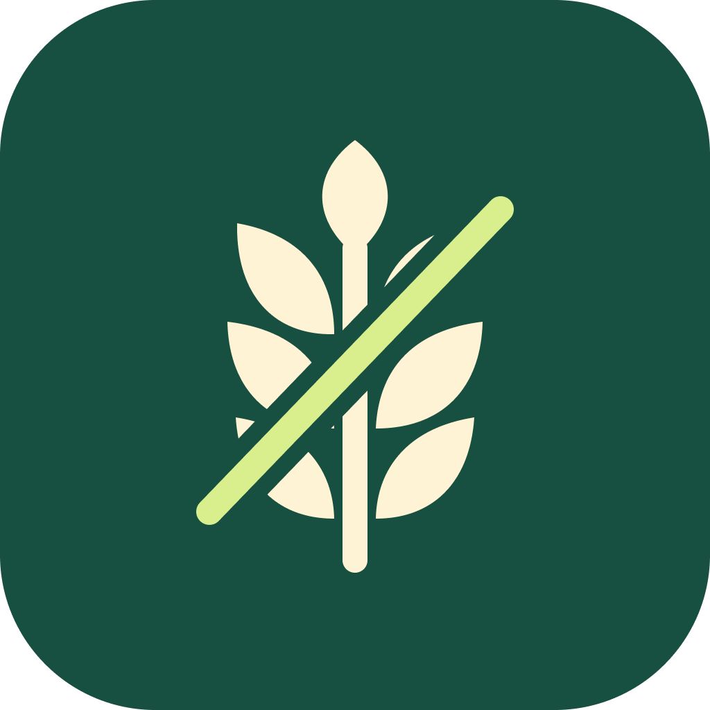

# 🌾 GluGlu

<p align="center">
  
</p>

<p align="center">
  Çölyak hastaları ve gluten hassasiyeti olan bireyler için glutensiz ürün ve mekân rehberi.
</p>

<p align="center">
  
  
  
  
</p>

---

## 📱 Uygulama Hakkında

**GluGlu**, çölyak hastalarının ve gluten hassasiyeti olan bireylerin günlük hayatını kolaylaştırmak için geliştirilen bir Flutter mobil uygulamasıdır. Glutensiz ürünleri arayabilir, yakındaki glutensiz mekânları görebilir, rehber makalelerini okuyabilir ve beslenme ihtiyaçlarınızı özetleyen bir sağlık kartı oluşturup paylaşabilirsiniz. Arayüz Türkçedir.

---

## ✨ Özellikler

### 🔐 Giriş
- E-posta ve şifre ile kayıt/giriş, benzersiz kullanıcı adı
- Hesap oluşturmadan misafir olarak devam etme
- Hesabı ve ilgili tüm verileri silme
- İlk açılışta tanıtım ekranları

### 🏠 Anasayfa
- Kişiselleştirilmiş karşılama ve öneri listeli arama kutusu
- Günün glutensiz ipuçları (kaydırılabilir)
- Popüler rehber konuları
- Yakındaki mekânlar

### 🔍 Ürün Arama
- Ürün, marka veya kategori adıyla arama
- Veritabanındaki kategorilerden oluşan filtre çipleri
- Ürün detayı: glutensiz / riskli / bilinmiyor rozeti, besin değerleri (100 g), içindekiler
- Ürünü paylaşma

### 📚 Rehber
- Üç grupta 9 rehber kategorisi: sağlık ve hastalık, beslenme ve tarifler, yaşam ve destek
- Makale listesi ve makale detayı (şu an 4 makale)
- Makaleyi favoriye ekleme

### 📍 Mekânlar
- Sayfalanan glutensiz mekân listesi (puan ve rozet bilgisiyle)
- Harita ekranı (OpenStreetMap), konumunuza göre görünüm

### ❤️ Favoriler
- Favori ürünler
- Favori makaleler

### 👤 Profil
- Profili düzenleme: ad, kullanıcı adı, doğum ve tanı tarihi, telefon, şehir
- Keşif özeti: aranan ürün sayısı, keşfedilen mekânlar, giriş serisi
- **Sağlık kartı:** beslenme ihtiyacınızı (çölyak, gluten hassasiyeti, buğday alerjisi, diğer), tüketemedikleriniz ve çapraz temas bilgisini tek kartta toplar. Tam ekran gösterilebilir, PNG olarak paylaşılabilir.

### 🚧 Henüz yok
Mekân favorileri, rozet sistemi, karanlık mod, dil seçimi, verileri indirme, şifre sıfırlama, gizlilik politikası ve kullanım koşulları sayfaları, Haftanın Markası. Bu alanlar arayüzde "Yakında" olarak görünür veya henüz yer tutucudur.

---

## 🛠️ Teknoloji Altyapısı

| Teknoloji | Kullanım Amacı |
|---|---|
| Flutter / Dart | Android ve iOS için tek kod tabanı |
| Firebase Authentication | E-posta ve misafir girişi |
| Cloud Firestore | Ürün, mekân, favori ve kullanıcı verisi |
| go_router | Sayfa yönlendirme, sekmeli kabuk, giriş yönlendirmesi |
| flutter_riverpod | Tema ve dil durumu |
| flutter_map + latlong2 | Harita (OpenStreetMap) |
| geolocator | Konum alma |
| google_fonts + Manrope | Yazı tipi (Manrope dosyaları uygulamayla birlikte gelir) |
| flutter_typeahead | Anasayfa arama önerileri |
| share_plus | Ürün ve sağlık kartı paylaşımı |
| bottom_picker | Kayıt ekranındaki doğum tarihi seçici |
| percent_indicator | Profildeki ilerleme göstergeleri |
| shared_preferences | Yerel tercihler |

---

## 📁 Proje Yapısı

Özellik odaklı (feature-first) düzen: her özellik kendi `data` ve `presentation` klasörünü taşır.

```
lib/
├── core/
│   ├── constants/        # app_sizes.dart, app_constants.dart (koleksiyon adları)
│   ├── providers/        # tema ve dil (Riverpod)
│   ├── routing/          # app_router.dart, main_shell.dart (alt sekmeler)
│   ├── services/         # konum servisi
│   ├── theme/            # app_colors.dart, app_theme.dart
│   ├── utils/            # doğrulayıcılar, tarih, snackbar, hata çevirici
│   └── widgets/          # ortak butonlar, metin alanı, güvenli ağ görseli
├── features/
│   ├── auth/             # giriş, kayıt, misafir girişi
│   ├── favorites/        # favori ürünler ve makaleler
│   ├── home/             # anasayfa
│   ├── onboarding/       # tanıtım ekranları
│   ├── product_detail/   # ürün detayı
│   ├── profile/          # profil, ayarlar, sağlık kartı, istatistikler
│   ├── search/           # ürün arama
│   ├── tips/             # rehber ve makaleler
│   └── venues/           # mekân listesi ve harita
└── main.dart
```

Her özellik klasöründe: `data/models` (değişmez modeller), `data/services` (Firestore ve Auth çağrıları, statik sınıflar), `presentation/screens` ve `presentation/widgets`. Ekranlar `StatefulWidget` ile çalışır, Riverpod yalnızca tema ve dil için kullanılır.

---

## 🚀 Kurulum

### Gereksinimler
- Flutter SDK (Flutter 3.38.5 ve Dart 3.10 ile geliştirildi)
- Android Studio veya VS Code
- Bir Firebase hesabı

### Adımlar

```bash
# Repoyu klonla
git clone https://github.com/Barisgul78/GluGlu.git

# Proje dizinine gir
cd GluGlu

# Bağımlılıkları yükle
flutter pub get

# Uygulamayı çalıştır (Firebase kurulumundan sonra)
flutter run
```

### Firebase Kurulumu

`google-services.json` ve `GoogleService-Info.plist` dosyaları gizli oldukları için repoda **yoktur**, kendi Firebase projenizle oluşturmanız gerekir.

1. [Firebase Console](https://console.firebase.google.com)'dan yeni bir proje oluşturun.
2. **Authentication** bölümünde *E-posta/Şifre* ve *Anonim* giriş yöntemlerini açın.
3. **Firestore Database** oluşturun.
4. Android uygulamasını paket adı `com.example.gluten_free` ile ekleyin, `google-services.json` dosyasını `android/app/` klasörüne koyun.
5. iOS uygulamasını bundle id `com.example.gluglu` ile ekleyin, `GoogleService-Info.plist` dosyasını `ios/Runner/` klasörüne koyun.
6. [Firebase CLI](https://firebase.google.com/docs/cli) ile giriş yapın, `.firebaserc` içindeki proje kimliğini kendi projenizle değiştirin ve güvenlik kurallarıyla indeksleri yükleyin:

   ```bash
   firebase deploy --only firestore
   ```

### Veri Modeli

| Koleksiyon | İçerik |
|---|---|
| `markalar/{marka}/marka_urunleri/{id}` | Ürünler (ad, marka, durum, kategori, içindekiler, besin değerleri) |
| `mekanlar/{id}` | Glutensiz mekânlar |
| `favoriler/{uid}` | Kullanıcının favori ürün, mekân ve makale kimlikleri |
| `users/{uid}` | Profil, sağlık kartı, istatistikler |
| `usernames/{ad}` | Kullanıcı adı rezervasyonu |

Ürün ve mekân verisi **uygulamadan yazılamaz** (güvenlik kuralları buna izin vermez), Firebase Console üzerinden girilir. Repoda hazır veri yükleme betiği yoktur. Makaleler Firestore'da değil, uygulama içinde sabit olarak tanımlıdır.

---

## 🧑‍💻 Geliştirici Notları

- Kalite kapısı: `flutter analyze`. Projede henüz otomatik test klasörü yoktur.
- Mimari ve kodlama kuralları için [CLAUDE.md](CLAUDE.md) dosyasına bakın.
- Tasarım dokümanları: [favori makaleler](docs/superpowers/specs/2026-07-02-favori-makaleler-design.md), [sağlık kartı](docs/superpowers/specs/2026-11-14-saglik-karti-design.md).
- Veritabanı güvenlik kuralları ve indeksleri: [firestore.rules](firestore.rules), [firestore.indexes.json](firestore.indexes.json).

---

## 📸 Ekran Görüntüleri

| Anasayfa | Rehber | Profil |
|---|---|---|
| _yakında_ | _yakında_ | _yakında_ |

---

## 🗺️ Yol Haritası

- [x] UI/UX tasarımı
- [x] Proje mimarisi
- [x] Kimlik doğrulama (giriş, kayıt, misafir)
- [x] Ürün veritabanı ve arama
- [x] Mekânlar ve harita
- [x] Favoriler (ürün, makale)
- [x] Sağlık kartı
- [ ] Rehber içeriklerinin genişletilmesi
- [ ] Mekân favorileri
- [ ] Rozet sistemi
- [ ] Bildirim sistemi
- [ ] Karanlık mod
- [ ] App Store & Google Play yayını

---

## 🤝 Katkıda Bulunanlar

| İsim | Rol |
|---|---|
| Barış Can Gül | Geliştirici |

---

## 📬 İletişim

Proje hakkında iş birliği veya öneri için:

- GitHub: https://github.com/Barisgul78
- E-posta: gulbariscan502@gmail.com

---

<p align="center">
  Türkiye'deki tüm çölyak hastaları için ❤️ ile geliştirildi
</p>
